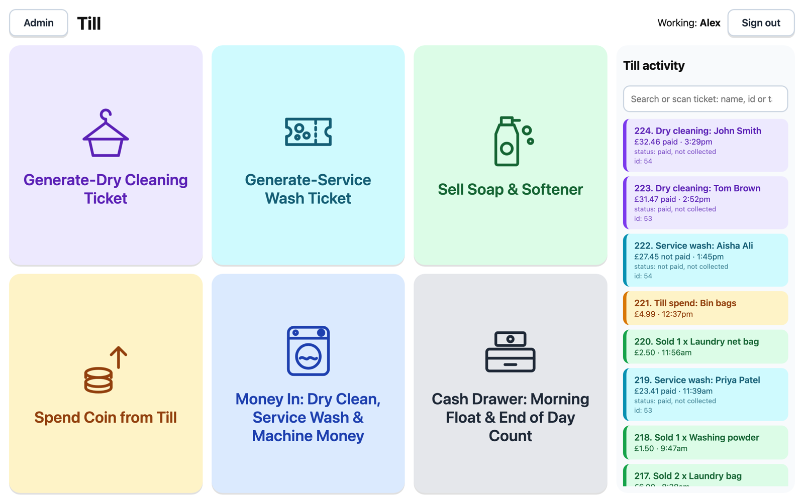
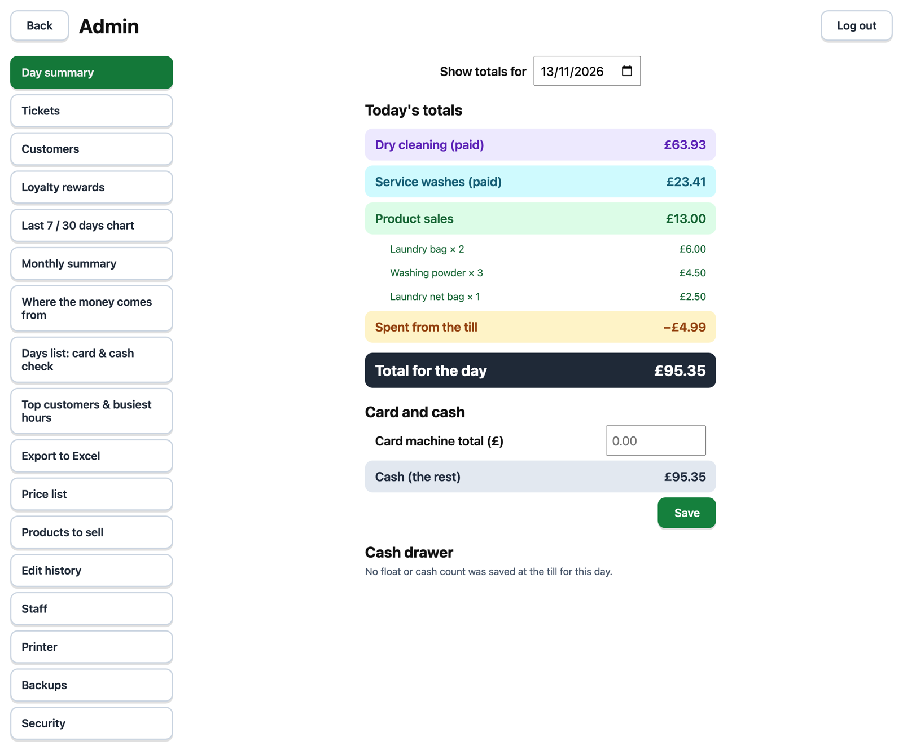
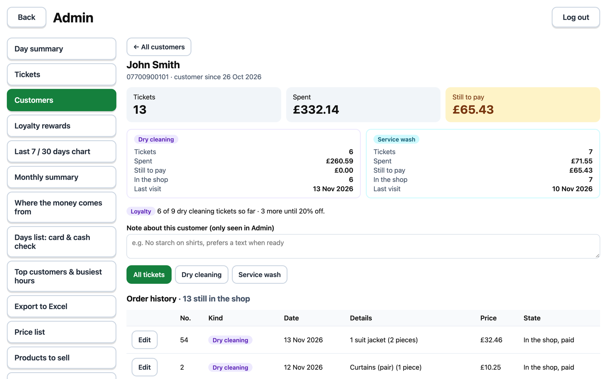

# Laundry Till

A point-of-sale and back-office app for a laundry and dry cleaning shop. Staff make tickets, sell
products and take money at a touch-friendly till; the owner gets daily takings, cash drawer checks,
customer profiles, reports, Excel and PDF exports, receipt printing and automatic backups.




## Features

**At the till**

- Dry cleaning tickets with items from the shop's price list, and service wash tickets by load size
- Deposits, discounts (% or £) and automatic loyalty rewards
- Product sales, money taken out of the till, and coins from the washers and dryers
- Collecting, marking ready (with rack slot), paying and cancelling tickets, with refunds
- Morning float and a blind end-of-day cash count
- Staff sign-in with PINs, so every action records who did it
- Printed tickets with barcodes and garment tags (ESC/POS over USB or network), and receipts on
  WhatsApp
- On-screen number pad for touchscreens, and a one-column layout for phones

**In Admin** (password protected)

- Day summary and closing the day with card and cash totals
- Ticket lists, a full ticket editor, uncollected tickets with WhatsApp reminders, ticket summaries
  as PDF
- Customer profiles worked out from tickets, with notes and loyalty progress
- 7 / 30 day chart, monthly summary (PDF), money sources, days list, top customers and busiest hours
- Export everything to Excel
- Price lists, products, staff, printer and receipt text
- An append-only edit history of every cancel, refund, price change and edit
- Automatic backups, one-click restore, a second copy on a USB stick, and a nightly backup even when
  the till is closed

| Admin day summary | Customer profile |
| --- | --- |
|  |  |

## Quick start

Requires Node.js 22 or newer.

```bash
# Terminal 1: the server, on http://localhost:3001
cd server
npm install
npm run set-password   # choose the admin password
npm run seed           # optional: made-up test data
npm run dev
```

```bash
# Terminal 2: the client, on http://localhost:5173
cd client
npm install
npm run dev
```

Open http://localhost:5173.

## Documentation

| Guide | What's in it |
| --- | --- |
| [User guide](docs/user-guide.md) | Every till and admin screen, with screenshots |
| [Setup and running](docs/setup.md) | Install, admin password, test data, settings, printers, backups, troubleshooting |
| [Architecture](docs/architecture.md) | How it fits together, the page map, ticket life cycle, security and the folder map |
| [Database](docs/database.md) | Entity relationship diagram and every table explained |
| [API reference](docs/api.md) | Every endpoint, who may call it and what it does |

## Project layout

```
laundry-till/
├── client/            React front end (Vite)
│   └── src/
│       ├── till/        the till screen and its pop-ups
│       ├── admin/       the admin area, one file per page
│       ├── components/  parts both use: number pad, pop-up frame, messages, printing bar
│       ├── utils/       server calls (api.js), dates, money, printing helpers
│       └── styles/      CSS split by area, loaded in order from styles/index.css
├── server/            Node.js back end (Express)
│   ├── routes/        one file per feature: admin, reports, price lists, till, tickets
│   ├── db/            connection and schema (one file per group of tables)
│   ├── lib/           shared logic: takings, cash drawer, customers, loyalty, backups
│   ├── auth/          admin password, staff PINs, access rules
│   ├── reports/       report numbers, PDF and Excel
│   ├── printing/      ESC/POS receipts, garment tags, WhatsApp text
│   ├── scripts/       seed, set-password, backup
│   └── data/          the database and backups (not in Git)
└── docs/              documentation and screenshots
```

## Tech stack

React 19 and Vite on the front end; Node.js 22, Express 5 and SQLite (`better-sqlite3`) on the
back end; `exceljs` for Excel and a small built-in PDF writer; `jsbarcode` for ticket barcodes.
The app runs entirely on the shop's own computer and needs no internet connection.

## License

[MIT](LICENSE)
