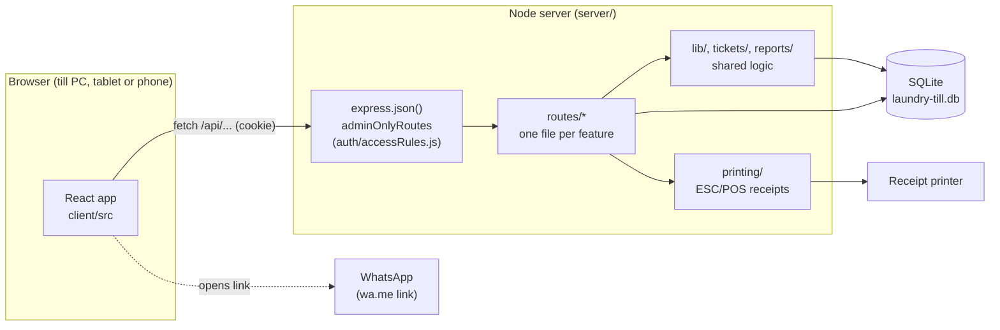
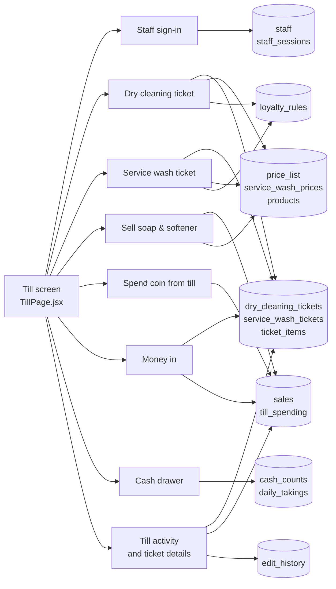
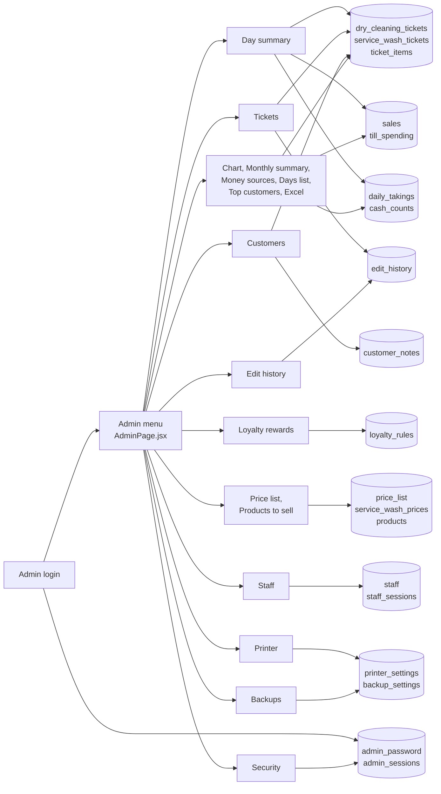
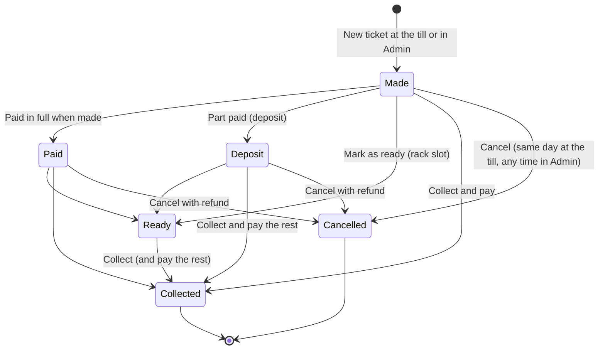

# Architecture

Laundry Till is a single-shop point-of-sale app. It runs on one computer in the shop, and any
tablet or phone on the shop's Wi-Fi can open it too.

| Part | Technology | Folder | Port |
| --- | --- | --- | --- |
| Front end | React 19, Vite, plain CSS | `client/` | 5173 (development) |
| Back end | Node.js 22, Express 5, ES modules | `server/` | 3001 |
| Database | SQLite through `better-sqlite3` | `server/data/laundry-till.db` | – |
| Printing | ESC/POS over USB (CUPS `lp`) or network (port 9100), or the browser's print window | `server/printing/` | – |
| Reports | Excel via `exceljs`, PDF via a small built-in writer | `server/reports/` | – |

The original plan used Supabase. The app was built on SQLite instead: it needs no internet
connection or account, keeps working if the shop's broadband drops, and the whole database is one
file that is easy to back up.

## How a request flows

1. The React app calls `/api/...` through `client/src/utils/api.js` (`loadJson` to read, `request` to
   save). In development, Vite forwards these calls to the server (`client/vite.config.js`).
2. `auth/accessRules.js` checks every URL. Admin URLs need the admin cookie. Till actions that save
   something need a signed-in worker once at least one worker exists (`requireStaff`).
3. The route file does the work, usually with shared helpers from `lib/`, and answers with JSON
   (or a PDF, Excel file or backup file).

## Page map

The app has two screens, chosen in `client/src/App.jsx`: the **Till** for staff and **Admin**
behind a password. There is no router; each screen opens its parts as pop-ups or tabs.

There are two maps: the till's pop-ups and the admin pages. Each arrow goes from a page to the
tables it reads or writes. The API each page calls is in the tables after the maps.

### Till

| Till part | Component | API |
| --- | --- | --- |
| Staff sign-in | `StaffSignIn.jsx` | `/api/staff`, `/api/staff/session`, `/api/staff/login`, `/api/staff/logout` |
| Dry cleaning ticket | `TicketForm.jsx`, `PriceListPicker.jsx`, `CustomerSuggestions.jsx`, `LoyaltyOffer.jsx` | `POST /api/dry-cleaning-tickets`, `/api/price-list`, `/api/customers/suggest`, `/api/loyalty/status` |
| Service wash ticket | `TicketForm.jsx` | `POST /api/service-wash-tickets`, `/api/service-wash-prices`, `/api/customers/suggest`, `/api/loyalty/status` |
| Sell soap & softener | `SellForm.jsx` | `/api/products`, `POST /api/sales` |
| Spend coin from till | `SpendForm.jsx` | `POST /api/till-spending` |
| Money in | `MoneyInForm.jsx`, `CollectTicket.jsx`, `CollectMachineMoney.jsx` | `/api/tickets/search`, `POST /api/:kind/:id/collect`, `POST /api/sales` |
| Cash drawer | `CashDrawerForm.jsx` | `/api/cash-drawer`, `/api/cash-drawer/float`, `/api/cash-drawer/count` |
| Till activity and details | `ActivitySidebar.jsx`, `ActivityDetails.jsx` | `/api/till-activity`, `/api/:kind/:id` and its `pay`, `ready`, `collect`, `cancel`, `print`, `whatsapp` |

### Admin

### Admin pages and the tables they read or write

| Admin page | Component | API | Tables |
| --- | --- | --- | --- |
| Day summary | `DaySummary.jsx`, `TakingsForm.jsx` | `GET /api/daily-summary`, `POST/PUT /api/daily-takings` | all ticket and money tables, `daily_takings`, `cash_counts` |
| Tickets | `TicketsSection.jsx`, `UncollectedTickets.jsx`, `TicketList.jsx`, `TicketEditor.jsx`, `TicketSummary.jsx` | `/api/admin/tickets`, `/api/uncollected-tickets`, `/api/reports/ticket-summary` | ticket tables, `ticket_items`, `edit_history` |
| Customers | `Customers.jsx` | `/api/admin/customers` | ticket tables, `customer_notes` |
| Loyalty rewards | `LoyaltyRewards.jsx` | `/api/admin/loyalty` | `loyalty_rules` |
| Last 7 / 30 days chart | `DaysChart.jsx` | `/api/daily-chart` | ticket tables, `sales`, `till_spending` |
| Monthly summary | `MonthlySummary.jsx` | `/api/reports/month`, `/api/reports/month-pdf` | ticket tables, `sales`, `till_spending`, `daily_takings` |
| Where the money comes from | `MoneySources.jsx` | `/api/reports/share` | ticket tables, `sales`, `products` |
| Days list | `DaysList.jsx` | `/api/reports/days` | `daily_takings`, `cash_counts`, ticket tables |
| Top customers & busiest hours | `CustomersAndHours.jsx` | `/api/reports/customers` | ticket tables |
| Export to Excel | `ExcelExport.jsx` | `/api/reports/excel` | everything with money, `staff` |
| Price list | `PriceListManager.jsx`, `ServiceWashPrices.jsx` | `/api/admin/price-list`, `/api/admin/service-wash-prices` | `price_list`, `service_wash_prices` |
| Products to sell | `ProductPrices.jsx` | `/api/admin/products` | `products`, `sales` |
| Edit history | `EditHistory.jsx` | `/api/admin/history` | `edit_history`, `staff` |
| Staff | `StaffManager.jsx` | `/api/admin/staff` | `staff`, `staff_sessions` |
| Printer | `PrinterSettings.jsx` | `/api/admin/printer` | `printer_settings` |
| Backups | `Backups.jsx` | `/api/admin/backups` | `backup_settings` (and the backup files) |
| Security | `SecuritySettings.jsx` | `/api/admin/change-password` | `admin_password`, `admin_sessions` |

## Ticket life cycle

Each change records who did it (`paid_by`, `collected_by`, `cancelled_by`) and when. Cancels,
refunds and admin edits are also written to `edit_history`.

## Security model

- **Admin password.** Only a scrypt hash with a random salt is stored (`auth/hashing.js`,
  `auth/adminAuth.js`). Logging in gives the browser a random token in an `HttpOnly`,
  `SameSite=Strict` cookie that lasts 12 hours. The database only stores the token's SHA-256 hash,
  so a copy of the database can't be used to log in.
- **Staff PINs.** Workers sign in with a 4–6 digit PIN, hashed the same way. Once at least one worker
  exists, the till refuses to save anything until someone is signed in, and every ticket, sale and
  refund records who did it.
- **Route protection.** `auth/accessRules.js` lists every admin URL prefix. The middleware checks it
  before any route runs, so a new admin route only needs adding to that list.
- **Local network only.** The server has no HTTPS of its own and is meant for the shop's own
  network. Don't expose port 3001 to the internet; put it behind a VPN or a reverse proxy with HTTPS
  if remote access is ever needed.

## Backups

`server/lib/backups.js` saves a full copy of the database when the server starts and every night,
in `server/data/backups/`. It keeps the last 30 days plus one per month for a year. Admin → Backups
can also back up now, download, restore and delete. Restoring first saves the current data, so a
restore can itself be undone. A USB stick or external drive can get a second copy of every backup
whenever it is plugged in (`lib/backupCopies.js`), and an operating-system job can back up at 22:30
even when the till isn't running (`lib/backgroundJob.js`: a launch agent on macOS, a scheduled task on
Windows, a crontab line on Linux).

## Folder map

Every source file starts with a comment saying what it does, and every route says which URL it
answers.

### Front end (`client/src`)

| Path | What it does |
| --- | --- |
| `main.jsx`, `App.jsx` | Starts React; switches between the till and admin screens. |
| `styles/` | All styles, split by area (`01-base.css`, `02-till.css`, `03-admin-reports.css`...) and loaded in order by `styles/index.css`, so later files win when two rules clash. One colour per kind of money, as CSS variables at the top of `01-base.css` (dry cleaning purple, service wash teal, sales green, machine money blue, spending amber, cancelled red). `admin/chartColors.js` must match. |
| `components/NumberPad.jsx` | The big on-screen number pad on touchscreens. |
| `components/Overlay.jsx` | The dark background behind pop-ups; click it or press Escape to close. |
| `components/Toast.jsx`, `components/PrintingBar.jsx` | Short "saved" messages, and the moving line while printing. |
| `till/TillPage.jsx` | The six big buttons, their pop-ups and the activity list. |
| `till/TicketForm.jsx`, `till/ticketTypes.js` | The new ticket form for both kinds of ticket. |
| `till/PriceListPicker.jsx`, `till/CustomerSuggestions.jsx`, `till/LoyaltyOffer.jsx` | Parts of the ticket form. |
| `till/SellForm.jsx`, `till/SpendForm.jsx` | Selling products; taking cash out of the till. |
| `till/MoneyInForm.jsx`, `till/CollectTicket.jsx`, `till/CollectMachineMoney.jsx` | The Money In pop-up. |
| `till/CashDrawerForm.jsx` | Morning float and end-of-day blind count. |
| `till/ActivitySidebar.jsx`, `till/ActivityDetails.jsx` | Today's activity list and the details pop-up with its actions. |
| `till/StaffSignIn.jsx`, `till/TillIcons.jsx` | Worker sign-in; button icons. |
| `admin/AdminArea.jsx`, `admin/AdminLogin.jsx`, `admin/AdminPage.jsx` | Password screen and the admin menu. |
| `admin/*.jsx` | One file per admin page (see the table above). |
| `utils/` | `api.js` (every call to the server: `loadJson` reads, `request` saves and returns `{ ok, data }`), `dates.js`, `money.js`, `ordinal.js`, `priceText.js`, `toast.js`, and `print.js` (print jobs and the browser print window, barcodes with `jsbarcode`). |

### Back end (`server`)

| Path | What it does |
| --- | --- |
| `index.js` | Starts the server: brings saved days up to date, starts backups and USB copies, closes the database cleanly on Ctrl+C. |
| `app.js` | The Express app and the list of every group of routes. |
| `routes/admin/` | Admin login, staff, tickets list and editor, day takings, chart, uncollected tickets, edit history, printer, backups, customers, loyalty. |
| `routes/reports/` | Monthly summary (and PDF), money sources, days list, top customers, ticket summary (and PDF), Excel. |
| `routes/priceLists/` | Dry cleaning prices, service wash prices, products. |
| `routes/till/` | Staff sign-in, customer search, sales, till spending, till activity, cash drawer. |
| `routes/tickets/` | New dry cleaning and service wash tickets; look up, pay, ready, collect, cancel; printing and WhatsApp receipts. |
| `routes/health.js` | `GET /api/health`. |
| `db/` | `connection.js` (opens the file), `index.js` (runs the schema), `schema/` (tables), `columns.js`, `defaultPriceList.js`. |
| `lib/` | Shared logic: `money.js`, `dates.js`, `takings.js` (day totals), `cashDrawer.js`, `customers.js`, `loyalty.js`, `editHistory.js`, `backups.js`, `backupCopies.js`, `backgroundJob.js`, `restore.js`. |
| `auth/` | `adminAuth.js`, `staffAuth.js`, `accessRules.js`, `hashing.js`, `cookies.js`. |
| `tickets/` | Helpers for the ticket routes: `ticketKinds.js`, `ticketDetails.js`, `ticketMoneyChecks.js` (discount and deposit), `ticketHistory.js`. |
| `reports/` | `moneyByDay.js`, `monthSummary.js`, `monthPdf.js`, `ticketSummary.js`, `ticketSummaryPdf.js`, `excelExport.js`, `pdfWriter.js`. |
| `printing/` | `printerModels.js` (presets), `printerSettings.js`, `receiptLayout.js`, `ticketReceipt.js`, `garmentTags.js`, `testPage.js`, `escpos.js`, `sendToPrinter.js`, `printAndAnswer.js`, `whatsappReceipt.js`. |
| `scripts/` | `seed.js`, `set-password.js`, `backup.js`, `nightly-backup.js`. |
