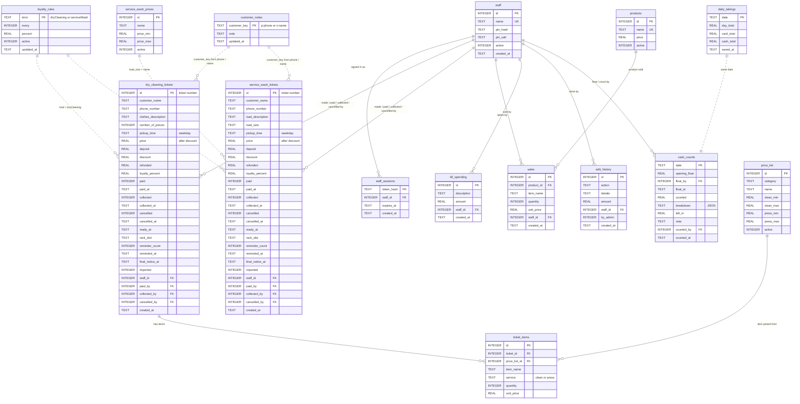
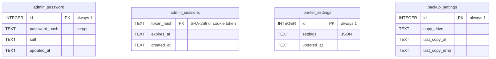

# Database

The till keeps everything in one SQLite file, `server/data/laundry-till.db`, opened with
[`better-sqlite3`](https://github.com/WiseLibs/better-sqlite3). The file is created the first time
the server starts. Set `DB_PATH` to keep it somewhere else.

- **Connection:** `server/db/connection.js` opens the file in WAL mode with foreign keys on.
- **Schema:** `server/db/schema/*.js`, one file per group of tables. `server/db/index.js` runs them in
  order every time the server starts. Each file creates its tables if they are missing, and adds any
  column that was added to the app later (`ALTER TABLE ... ADD COLUMN`), so an old database is brought
  up to date without losing data. There is no separate migration tool.
- **Money** is stored as `REAL` pounds rounded to 2 decimal places. `CHECK` constraints reject
  negative amounts and amounts with more than 2 decimals.
- **Booleans** are `INTEGER` 0 or 1 (`paid`, `collected`, `cancelled`, `active`...).
- **Dates and times** are `TEXT` in the shop's local time, `YYYY-MM-DD HH:MM:SS`
  (`datetime('now', 'localtime')`). Days are `YYYY-MM-DD`.
- **Nothing is hard-deleted** in day-to-day use. Staff, products and price list items get
  `active = 0`, so old tickets and sales still point at them. Tickets are cancelled, not deleted.

## Entity relationship diagram

Solid lines are real foreign keys (`REFERENCES`). Dotted lines are links the app makes in code
(matching a name, a day or a phone number) without a foreign key.

These four tables stand alone, with one row each at most (`id = 1`) except `admin_sessions`:

## Tables in detail

### Tickets

**`dry_cleaning_tickets`** and **`service_wash_tickets`** (`schema/tickets.js`) hold one row per
ticket. The `id` is the ticket number printed on the receipt and in its barcode (`D123` or `S123`).
Both tables have the same life-cycle columns:

| Column | Meaning |
| --- | --- |
| `customer_name`, `phone_number` | Who the ticket is for. The phone number also identifies the customer (see *Customers* below). |
| `clothes_description`, `number_of_pieces` | Dry cleaning only: what was brought in. |
| `load_description`, `load_size` | Service wash only. `load_size` is the name of a row in `service_wash_prices` when the ticket was made. |
| `pickup_time` | The weekday the customer will collect (`Monday` ... `Sunday`). |
| `price` | What the customer pays **after** any discount. All totals use it as it is. |
| `discount` | Money taken off (0 if none). `price + discount` is the price before the discount. |
| `loyalty_percent` | The loyalty reward given on this ticket, if any. Its money off is included in `discount`. |
| `deposit` | Money taken when the ticket was made. The rest (`price - deposit`) is paid on collection. |
| `paid`, `paid_at`, `paid_by` | Whether, when and by whom it was fully paid. |
| `ready_at`, `rack_slot` | When the clothes came back and were marked ready, and where they hang. |
| `collected`, `collected_at`, `collected_by` | When the customer picked it up. |
| `cancelled`, `cancelled_at`, `cancelled_by`, `refunded` | Cancelling a ticket. `refunded` is money given back, taken off that day's total. |
| `reminder_count`, `reminded_at`, `final_notice_at` | WhatsApp reminders sent from Admin → Uncollected tickets. |
| `imported` | 1 for a ticket holding a whole day's money brought in from the shop's old spreadsheet. It counts towards money, but not as a customer ticket. |
| `staff_id` | The worker signed in on the till when it was made (empty when made in Admin). |

**When money counts.** A ticket's money counts on the day it was paid, not the day it was made.
A deposit counts on the day it was taken, and the rest on the day it was paid. A refund is taken
off on the day of the cancel. This logic lives in `server/lib/takings.js`.

**`ticket_items`** lists the items on a dry cleaning ticket picked from the price list,
for example 2 × Shirt (dry clean) at £3.50. `item_name` and `unit_price` are copied when the ticket is
made, so changing the price list later doesn't change old tickets.

### Price lists and products

| Table | Meaning |
| --- | --- |
| `price_list` | The dry cleaning price list. Each item has a *Dry clean* and a *Press only* price, each a range (`min` to `max`; the same number for a fixed price). Filled from `server/db/defaultPriceList.js` the first time. |
| `service_wash_prices` | Service wash load sizes and their price range, e.g. *Small load* £14–£16. The till only accepts a price inside the range. |
| `products` | Things sold over the counter (soap, softener, bags). `active = 0` hides one from the till. |

### Money that isn't a ticket

| Table | Meaning |
| --- | --- |
| `sales` | One row each time something is sold. `product_id` is empty for an *Other* item typed in at the till. Coins taken from the washers and dryers are saved here as a sale called *Washers Dryers Coins*. |
| `till_spending` | Cash taken out of the till to pay for something, e.g. *Milk*, £1.20. |
| `daily_takings` | A closed day: `day_total` (everything taken minus till spending), the `card_total` typed from the card machine, and `cash_total` (the rest). Saved from Admin → Day summary or the till's end-of-day count. |
| `cash_counts` | The cash drawer for one day: the morning `opening_float`, the `counted` cash at closing (and its note-by-note `breakdown`), and how much is `left_in` for tomorrow. What the drawer *should* hold is worked out, not stored (`server/lib/cashDrawer.js`). |

### People and access

| Table | Meaning |
| --- | --- |
| `staff` | Shop workers. Only a scrypt hash of the 4–6 digit PIN is stored. |
| `staff_sessions` | Which worker is signed in on which till. The browser keeps a random token in a cookie; only its SHA-256 hash is stored. |
| `admin_password` | The one admin password, as a scrypt hash and salt. Set with `npm run set-password`. |
| `admin_sessions` | Logged-in admin browsers, hashed the same way. A log-in lasts 12 hours. |

### Customers, loyalty and history

| Table | Meaning |
| --- | --- |
| `customer_notes` | Notes the admin keeps about a customer. There is no customers table: a customer is everyone with the same phone number on their tickets, or the same name when no real number was given. `customer_key` is `p:07700900123` or `n:sarah` (`server/lib/customers.js`). |
| `loyalty_rules` | One rule per kind of ticket: every *N*th ticket gets *X*% off. |
| `edit_history` | An append-only log of every cancel, refund, card amount, price change and admin edit, with who did it. |

### Settings

| Table | Meaning |
| --- | --- |
| `printer_settings` | The receipt printer, garment tags and receipt text, stored as one JSON object (explained in `server/printing/printerSettings.js`). |
| `backup_settings` | Which USB stick or external drive gets a second copy of every backup. |

## Working with the database by hand

- **Back up first:** `cd server && npm run backup -- <name>` saves `data/before-<name>-<date>.db`.
- **Don't copy the `.db` file while the server is running.** Recent changes can still be in the
  `-wal` file next to it. Stop the server with Ctrl+C first, or use Admin → Backups → *Back up now*.
- **After editing tickets, sales or spending by hand, recalculate saved days.** `daily_takings`
  stores each closed day's totals, so a change to an old day leaves that row out of date. The server
  brings saved days up to date when it starts, so restarting it is enough.
- **Test data:** `npm run seed` adds made-up tickets, sales and spending for the past 7 days (it saves
  a backup first). `npm run seed -- 14` for 14 days, `npm run seed -- today` for today only.
